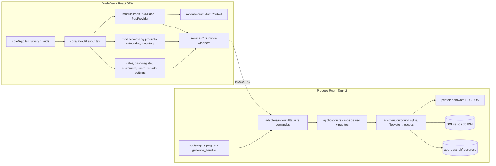
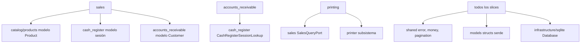
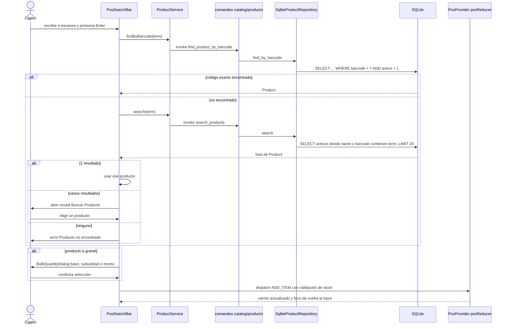
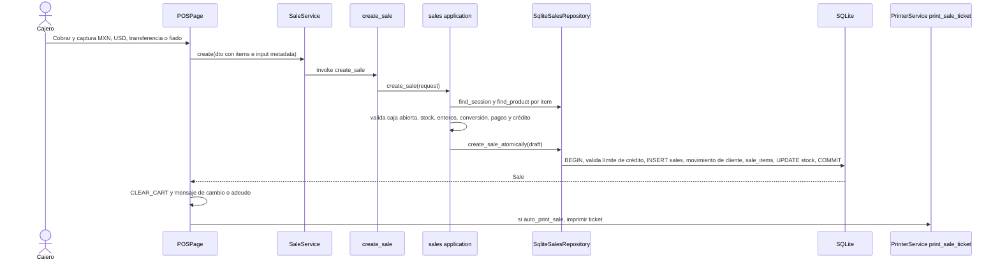
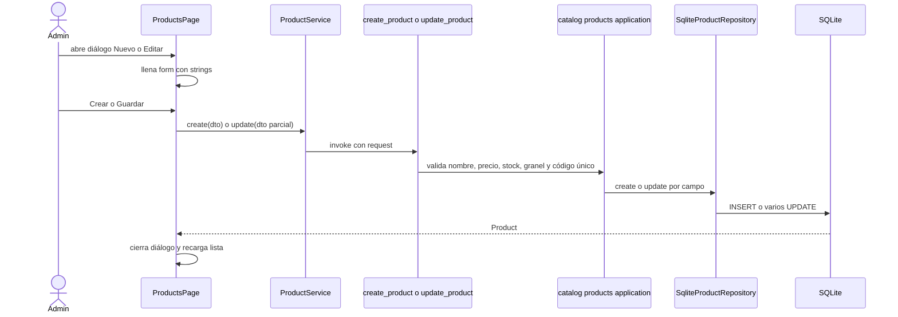
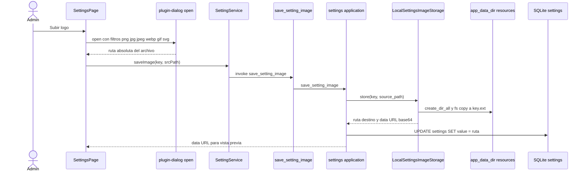

# Arquitectura — Almanza POS Desktop

## Architecture Analysis

### System Overview

Aplicación de escritorio monolítica construida con **Tauri 2**: un único proceso nativo en Rust aloja una WebView que ejecuta una SPA de **React 19 + MUI 7**. La SPA no habla con ninguna red: toda operación de negocio cruza el puente IPC de Tauri (`invoke()`) hacia comandos Rust que aplican reglas de negocio y persisten en un archivo **SQLite** (`pos.db`) dentro del directorio de datos de la aplicación. Las impresoras térmicas se controlan desde Rust (puerto serie USB o spooler de Windows). Los archivos de imagen (hoy solo el logotipo) se copian a `<app_data_dir>/resources/`.

### Architectural Style

**Monolito de escritorio en dos capas de proceso** (UI WebView + núcleo Rust) con:

- **Backend hexagonal por slices verticales** (`src-tauri/src/modules/<slice>/`): cada slice tiene `application.rs` (casos de uso como funciones libres + traits de puerto), `adapters/inbound/tauri.rs` (comandos IPC) y `adapters/outbound/{sqlite,filesystem,escpos}.rs` (implementaciones de puertos). Evidencia: `modules/catalog/products/application.rs` define `trait ProductRepository`; `adapters/outbound/sqlite.rs` lo implementa con `SqliteProductRepository<'db>`; el comando construye el adaptador por llamada (`SqliteProductRepository::new(&db)`).
- **Frontend modular por dominio** (`src/modules/<dominio>/{pages,components,services,types,context,utils}`), con servicios estáticos que envuelven `invoke()` y estado local por página (`useState`), más dos contextos: `AuthContext` (global) y `PosProvider` (solo ruta `/pos`, `useReducer`).
- **Persistencia embebida**: un `Database { conn: Mutex<Connection> }` gestionado como estado de Tauri; WAL y `foreign_keys=ON`; migraciones versionadas con checksum.

### Component Relationships

Texto alternativo: la SPA (App → Layout → páginas de dominio) llama a servicios TypeScript; estos invocan comandos IPC registrados en `bootstrap.rs`; cada comando delega en la capa `application` del slice, que usa adaptadores salientes hacia SQLite, el sistema de archivos (imágenes) o el subsistema de impresora.

Dependencias entre slices del backend (solo por puertos o adaptadores, sin ciclos):

Texto alternativo: `sales` lee productos, sesiones y clientes con su propio SQL; `accounts_receivable` consulta sesiones mediante el trait `CashRegisterSessionLookup`; `printing` lee ventas mediante `SalesQueryPort` y usa `printer/`; todos dependen de `shared`, `models` e `infrastructure/sqlite`.

### Data Flow

1. La UI mantiene el estado en memoria (React); los montos se calculan con `decimal.js` para retroalimentación inmediata.
2. Al confirmar, el servicio envía un DTO `snake_case` vía `invoke('<comando>', { request })`.
3. El comando Rust deserializa el request (`serde`), toma el `State<Database>`, construye el adaptador y llama al caso de uso.
4. El caso de uso valida (errores `AppError::{Validation, NotFound, Conflict, Database, Auth}` serializados como cadena en español) y delega en el adaptador, que bloquea el `Mutex<Connection>`, ejecuta SQL (con transacción en ventas, cancelaciones, abonos, ajustes y migraciones) y vuelve a leer la entidad.
5. La respuesta se serializa a JSON y regresa a la UI; los errores llegan como `string` y se muestran en `Alert`.
6. Estado persistente fuera de SQLite: sesión de login en `localStorage` (`pos_session`); logotipo en `<app_data_dir>/resources/<key>.<ext>`.

### Key Design Decisions

| Decisión | Evidencia | Implicación |
|---|---|---|
| Backend hexagonal por slices | `modules/*/application.rs` con traits | Los casos de uso son testeables con dobles; agregar una capacidad = nuevo puerto + adaptador |
| Una conexión SQLite con `Mutex` | `infrastructure/sqlite/database.rs` | Simplicidad y atomicidad; todo acceso a BD está serializado |
| Migraciones versionadas con checksum FNV-1a y detección de esquema heredado | `migrations.rs` | Cambios de esquema = nuevo `000N_*.sql` + entrada en `MIGRATIONS`; nunca editar una migración aplicada |
| Errores como cadenas en español | `shared/error.rs` (`Serialize` → string) | La UI muestra `String(err)` directamente; no hay códigos de error estructurados |
| Aritmética monetaria explícita | `shared/money.rs`, `modules/shared/utils/money.ts` | Toda nueva lógica de precio/cantidad debe usar estos helpers |
| Autorización solo en la UI | `core/guards/AuthGuard.tsx`; comandos sin chequeo de rol | Cualquier invocación IPC puede ejecutar comandos admin; riesgo aceptado en PoC |
| Imágenes como data URL base64 | `settings/adapters/outbound/filesystem.rs` | Sin configurar el protocolo de assets; costoso para muchas imágenes |
| `PosProvider` acotado a `/pos` | `core/App.tsx:40-42` | El carrito y cualquier estado del POS se pierden al navegar a otra ruta |

### Improvement Opportunities

- Validar rol/usuario en backend en lugar de confiar en `user_id` del cliente; habilitar una CSP.
- Sustituir `.ok()` por `.optional()?` en búsquedas para no ocultar errores de base de datos.
- Hacer transaccionales las actualizaciones parciales y permitir limpiar campos anulables (necesario para "quitar imagen").
- Centralizar el mapeo de `Product` (hoy duplicado en `sales`).
- Habilitar el protocolo de assets con alcance acotado (o un comando de miniaturas) para servir imágenes de producto sin base64 masivo.
- Agregar índice o columna normalizada para búsqueda por nombre (prefijo, sin acentos) si el catálogo crece.
- Actualizar la sección Architecture de `AGENTS.md`, que describe la estructura previa a la migración hexagonal.

## Interaction Diagrams

### Agregar producto al carrito por búsqueda / escaneo (flujo actual)

Texto alternativo: Enter dispara primero una búsqueda exacta por código; si falla, una búsqueda `LIKE` por contenido (máx. 20, solo activos). Un resultado se agrega directo, varios abren el modal de selección, ninguno muestra error. Los productos a granel pasan por `BulkQuantityDialog`. El reductor valida stock y fusiona líneas iguales.

### Cobro de una venta

Texto alternativo: la UI envía la venta; el caso de uso recalcula precios y totales desde la BD, valida reglas y delega la escritura atómica (venta, partidas, descuento de stock y cargo a cliente) en una sola transacción; después la UI limpia el carrito e imprime si está configurado.

### Alta / edición de producto (flujo actual, sin imagen)

Texto alternativo: el formulario construye un DTO; el caso de uso valida y verifica unicidad del código de barras; el adaptador inserta o actualiza campo por campo (cada `Some` genera un `UPDATE`); la página recarga la lista completa.

### Guardado de imagen (patrón existente del logotipo, base para imágenes de producto)

Texto alternativo: el selector nativo devuelve una ruta; Rust copia el archivo a `resources/<key>.<ext>`, guarda la ruta absoluta en el setting y devuelve un data URL base64 que la UI usa como `src`. Para leerlo después, `get_setting_image` relee el archivo y lo codifica de nuevo.
