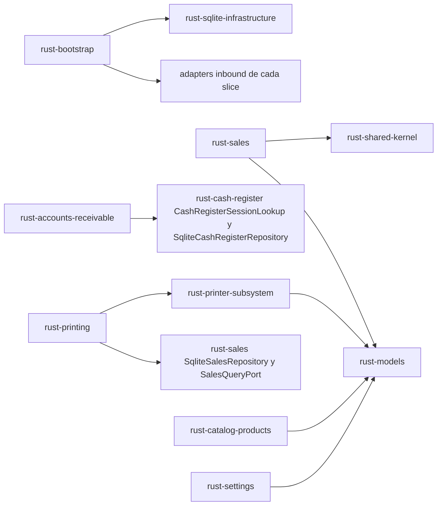
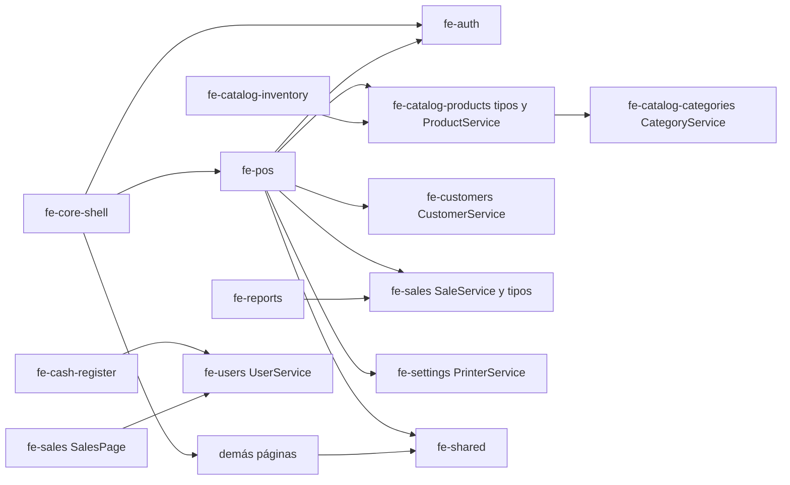

# Dependencias — Almanza POS Desktop

Las versiones exactas están en `technology-stack.md`; aquí se documentan quién depende de qué y los acoplamientos internos.

## Dependencias externas por área

| Área | Dependencia externa | Usada por |
|---|---|---|
| IPC | `tauri`, `@tauri-apps/api/core` (`invoke`) | Todos los adaptadores inbound y todos los servicios TS |
| Persistencia | `rusqlite` (SQLite embebido) | `rust-sqlite-infrastructure` y todos los adaptadores `sqlite.rs` |
| Seguridad | `bcrypt`, `uuid` | `rust-identity`, semilla de usuario en migraciones |
| Archivos | `std::fs` (sin plugin) | `rust-settings` (`LocalSettingsImageStorage`), `rust-sqlite-infrastructure` |
| Archivos (UI) | `@tauri-apps/plugin-dialog` (`open`, `save`), `@tauri-apps/plugin-fs` (`writeFile`), `@tauri-apps/api/path` | `fe-settings` (logotipo), `fe-reports` (exportaciones) |
| Impresión | `serialport`, `windows`, `tokio`, `async-trait`, `deunicode`, PowerShell `Get-Printer` | `rust-printer-subsystem`, `rust-printing` |
| UI | `react`, `@mui/*`, `@emotion/*`, `react-router-dom` | Todo el frontend |
| Cálculo | `decimal.js` | `fe-shared` (`money.ts`, `unitConversion.ts`), `fe-pos` |
| Fechas | `moment` (+ `@mui/x-date-pickers` AdapterMoment), `date-fns` | Páginas con filtros de fecha, `fe-core-shell` |
| Reportes | `jspdf`, `jspdf-autotable`, `exceljs` | `fe-reports` |

No hay servicios de red externos, bases remotas ni APIs de terceros.

## Dependencias internas del backend



Texto alternativo: el bootstrap depende de todos los adaptadores inbound y de la infraestructura SQLite. Las únicas dependencias cruzadas entre slices son: `accounts_receivable` → `cash_register` (trait de búsqueda de sesión y su adaptador SQLite, cableado en el comando `register_customer_payment`), `printing` → `sales` (lectura de ventas mediante `SalesQueryPort`/`SaleReader`) y `printing` → `printer/`. Todos los slices dependen de `models`, `shared` e `infrastructure/sqlite`. No hay ciclos.

Acoplamientos por SQL (no por trait):
- `rust-sales` lee directamente `products`, `categories`, `cash_register_sessions`, `customers`, `customer_account_movements` y escribe `products.stock`.
- `rust-accounts-receivable` lee `settings.default_customer_credit_limit`.
- `rust-cash-register` lee `sales` y `customer_account_movements` para el resumen.
- `rust-printing` lee/escribe claves `printer_*` y lee `business_*`/`ticket_*` en `settings`.
- `rust-identity` y `rust-catalog-products` consultan tablas de historial para bloquear borrados.

## Dependencias internas del frontend



Texto alternativo: el shell monta el contexto de autenticación y las páginas. `fe-pos` depende de los tipos y servicio de productos, del servicio de clientes (fiado), del servicio de ventas, del servicio de impresora (en settings) y de utilidades compartidas. Productos usa el servicio de categorías; inventario usa el servicio de productos; reportes usa el servicio de ventas; caja y ventas usan el servicio de usuarios. Todas usan `fe-shared`.

Observación: `PosSearchBar` y `BulkQuantityDialog` importan `getRequestedProductQuantityAfterAdd` de `PosProvider`, y `PosProvider` importa utilidades de `fe-shared`; no hay ciclos.

## Dependencias de datos (esquema)

```text
users ──< cash_register_sessions ──< sales ──< sale_items >── products >── categories (ON DELETE SET NULL)
users ──< inventory_adjustments >── products
customers ──< customer_account_movements >── sales (opcional), cash_register_sessions (obligatorio desde 0006)
settings (clave/valor tipado: string, multiline, number, boolean, image_path)
schema_migrations (versión, checksum, fecha)
```

Índices: `products(barcode)`, `sales(cash_register_session_id)`, `sales(created_at)`, `sales(customer_id)`, `sale_items(sale_id)`, `inventory_adjustments(product_id)`, `customer_account_movements(customer_id|created_at|cash_register_session_id)`. No hay índice sobre `products.name` ni `products.category_id`.

## Impacto de dependencias para el intent

| Cambio previsto | Componentes afectados |
|---|---|
| Columna de imagen en `products` | `rust-sqlite-infrastructure` (0007), `rust-models`, `rust-catalog-products` (SQL y mapeo), `rust-sales` (`find_product` y fixtures), `fe-catalog-products` (tipos), `fe-pos` (tarjetas) |
| Almacenamiento de imagen de producto | Nuevo puerto/adaptador en `rust-catalog-products` siguiendo `rust-settings`; `rust-bootstrap` (registro de comandos); posiblemente `tauri.conf.json`/capabilities si se usa protocolo de assets |
| Sugerencias en vivo | `fe-pos` (`PosSearchBar`), `ProductService`; opcionalmente `rust-catalog-products` (`search` con prefijo/límite) |
| Vista de cuadrícula | `fe-pos` (`POSPage`), `ProductService.getActive` / `get_active_products`, `CategoryService` (opcional), `fe-shared` |
| Preferencia de vista por sesión | `fe-pos` o `fe-auth`; `sessionStorage` del WebView (hoy sin uso) |
