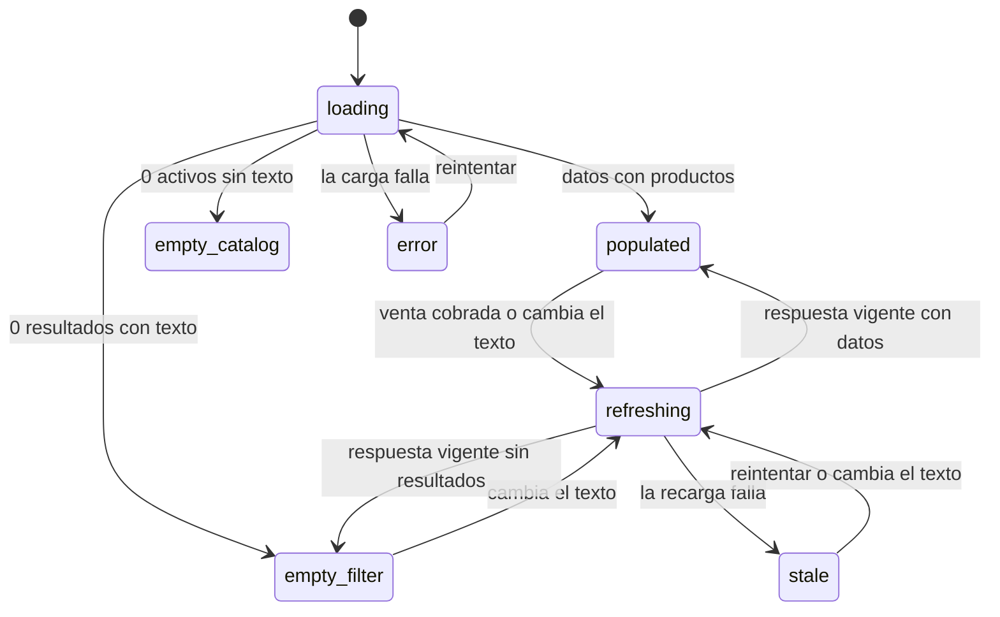

# Especificación funcional — U3 pos-grid-view

Unidad `ui` (U3). Agrega al POS la vista de cuadrícula de productos activos, agrupada por categoría, ordenable y filtrada por la barra de búsqueda, y la preferencia de vista por sesión de login. No hay entidades ni reglas de negocio propias: esta especificación es autónoma y define los flujos, los estados y los contratos con U1 y U2. Los componentes y su comportamiento visual están en `frontend-components.md`.

## Decisiones de este diseño

- **P1 = A**: después de agregar desde una tarjeta, el foco **vuelve a la barra de búsqueda**, igual que en la vista de lista. Así un escaneo justo después de tocar una tarjeta cae en la barra y agrega el producto escaneado una sola vez (FR2.12, NFR3). Repetir un producto exige volver a tocar su tarjeta [P1].
- **P2 = A**: el carrito compacto muestra el **precio base** en la segunda línea de cada fila, junto a la cantidad, y el total de la partida a la derecha [P2].
- **P3 = A**: tocar una tarjeta agotada muestra el mismo aviso que una sugerencia agotada, "Stock insuficiente. Disponible: 0". La venta no cambia [P3].
- La **regla de coincidencia** vive una sola vez, en el backend (U2). Sin texto, la cuadrícula carga los productos con `get_active_products`; con texto, llama a `suggest_products` sin límite. No se duplica la regla en TypeScript.
- El **agrupado y el orden** se calculan en la pantalla sobre la lista recibida, con funciones puras.
- El **flujo de agregado** es el de la barra (`handleSuggestionSelected`: relee el producto por id, valida stock, abre el diálogo a granel o agrega con cantidad 1). Las tarjetas lo invocan a través de un manejador expuesto por `PosSearchBar`; no se copia la lógica.
- **Sin caja abierta**, el POS ya muestra "No hay una caja abierta" y no monta la barra ni la cuadrícula; U3 no agrega un estado nuevo.

## Contratos con otras unidades

### Con U2 (regla de coincidencia y barra)

```text
suggest_products(term: texto, limit: ausente) -> lista de Product activos que contienen term
get_active_products() -> lista de Product activos (ya existe, no se usaba)
```

- `PosSearchBar` conserva `suggestionsEnabled`; U3 lo pone en `false` en vista de cuadrícula (FR1.10, W6).
- `PosSearchBar` publica el texto con `onTermChange(term)` en cada cambio y expone un manejador `addProduct(product)` que ejecuta el flujo de selección de la barra (relectura, stock, granel, cantidad 1) y devuelve el foco a la barra.

### Con U1 (imagen)

```text
productImageSource(image_file: texto o nulo) -> URL mostrable o nulo
```

La tarjeta usa el contrato definido en U1. Mientras la fuente carga, o si es nula o falla, muestra el placeholder (FR4.12). La carpeta de imágenes se obtiene una vez y se guarda en memoria.

## Reglas de la cuadrícula

Referencias internas de esta especificación (no son `BRx.y`; este diseño no tiene `rules.md`):

- **G1 — Productos.** Solo activos; los inactivos nunca aparecen (FR2.3).
- **G2 — Filtro.** Desde el primer carácter, con la regla de U2 (contiene, en nombre o código, sin distinguir mayúsculas ni acentos), tras 100 ms sin teclear. Sin texto, todos los activos (FR2.6).
- **G3 — Respuesta vigente.** Cada carga o filtro lleva un número de secuencia. Cualquier cambio de texto, incluso borrarlo, invalida lo que está en vuelo; solo se aplica la respuesta más reciente.
- **G4 — Grupos.** Un grupo por categoría, ordenados alfabéticamente con la misma normalización (sin acentos ni mayúsculas); "Sin categoría" al final. Un grupo sin productos tras el filtro no se muestra (FR2.4, FR2.7).
- **G5 — Orden.** Dentro de cada grupo, por nombre, precio o stock, ascendente o descendente; por defecto nombre ascendente. El empate se resuelve por nombre ascendente normalizado y luego por id (FR2.5). El orden elegido no se recuerda entre visitas al POS.
- **G6 — Agotado.** Una tarjeta con `stock <= 0` se muestra atenuada, con el texto "Agotado", y no se agrega; al tocarla se muestra "Stock insuficiente. Disponible: 0" (FR2.9, P3).
- **G7 — Contenido.** Imagen o placeholder, nombre, código, stock con su unidad y precio en MXN; "A granel" como chip cuando aplica (FR2.3).
- **G8 — Stock vigente.** Después de una venta cobrada, la cuadrícula recarga los productos (FR2.11).
- **G9 — Preferencia.** La vista elegida se guarda por sesión de login, fuera de la base de datos, y se borra al cerrar sesión (FR3).

## Estados de la cuadrícula

| Estado | Qué se ve | Cómo se llega |
|---|---|---|
| `loading` | Esqueleto de tarjetas | primera carga o reintento |
| `error` | `Alert` "No se pudieron cargar los productos" con "Reintentar" | falla la carga sin datos previos |
| `empty-catalog` | "No hay productos activos" | 0 productos activos y sin texto |
| `empty-filter` | "Sin coincidencias para «texto»" y "Limpiar búsqueda" | filtro sin resultados |
| `populated` | Grupos con tarjetas | datos disponibles |
| `refreshing` | Las tarjetas actuales se conservan; un indicador discreto de 2 px indica la recarga | recarga tras una venta o cambio de filtro con datos previos |
| `stale` | Las tarjetas actuales se conservan y un aviso discreto dice "No se pudo actualizar el stock" con "Reintentar" | falla una recarga con datos previos |



Texto alternativo del diagrama: la cuadrícula empieza en `loading` y termina en `populated`, `empty_catalog`, `empty_filter` o `error`. Con datos previos, una venta cobrada o un cambio de texto pasa a `refreshing`; ahí termina en `populated` o `empty_filter`, o en `stale` si la recarga falla, y `stale` vuelve a `refreshing` al reintentar o al cambiar el texto.

## Flujos

### W1 — Cambiar de vista (FR2.1, FR2.2, FR3.1; AC2.1)

1. El cajero activa "Vista de cuadrícula" en el selector. El texto de la barra se conserva.
2. El POS monta la cuadrícula y el carrito compacto en la columna derecha de 360 px; el panel "Resumen de Venta" y "Cobrar" siguen visibles y sin cambios (AC2.1).
3. Se guarda la preferencia (W8) y el foco vuelve a la barra.
4. Al volver a lista, la lista de sugerencias no se reabre hasta que cambie el texto.

### W2 — Cargar y filtrar (FR2.6, FR2.7, FR2.10; AC2.4, AC2.8)

1. Al entrar a la cuadrícula se pide `get_active_products` (estado `loading`).
2. Cada cambio de texto espera 100 ms. Sin texto se muestran todos los activos; con texto se pide `suggest_products` sin límite.
3. Solo se aplica la respuesta vigente (G3). Los grupos sin coincidencias desaparecen (AC2.4).
4. Sin resultados con texto: "Sin coincidencias para «texto»" y "Limpiar búsqueda" (AC2.8). Al limpiar, se vacía la barra y el foco vuelve a ella.
5. Al cambiar el filtro, el scroll de la cuadrícula vuelve arriba.

### W3 — Agrupar y ordenar (FR2.4, FR2.5; AC2.2, AC2.3)

1. Los productos se agrupan por categoría y los grupos se ordenan alfabéticamente, con "Sin categoría" al final (AC2.2).
2. El selector de orden (criterio y dirección) aplica a cada grupo; el desempate es por nombre (AC2.3). Cambiar el orden no recarga datos.

### W4 — Agregar desde una tarjeta (FR2.8; AC2.5)

1. El cajero toca la tarjeta o presiona Enter o Espacio sobre ella.
2. Se invoca `addProduct(product)` de la barra: relee el producto por id, valida el stock actual y agrega con cantidad 1, o abre el diálogo a granel si el producto es a granel (AC2.5).
3. Al agregarse, el foco vuelve a la barra (P1). **El texto de la barra no se borra** cuando el producto viene de una tarjeta: el filtro sigue aplicado para agregar otro producto del mismo grupo.
4. Si la relectura falla o el producto ya no está activo, se muestra "Producto no encontrado" y se recarga la cuadrícula.
5. Si el cajero cancela el diálogo a granel, no cambia nada.

### W5 — Tarjeta agotada (FR2.9; AC2.6)

1. Una tarjeta con `stock <= 0` se ve atenuada y con el texto "Agotado" (no solo por color).
2. Al tocarla, tras la relectura de W4, se muestra "Stock insuficiente. Disponible: 0". No se abre el diálogo a granel y la venta no cambia (AC2.6, P3).

### W6 — Escaneo en vista de cuadrícula (FR2.12, NFR3)

1. El foco inicial y el foco tras cada alta están en la barra (P1), así que el lector de código escribe dígitos y Enter en la barra.
2. Enter ejecuta el flujo actual (código exacto → coincidencias → agregar, modal o error). La lista de sugerencias no se abre en cuadrícula (`suggestionsEnabled = false`).
3. Los dígitos que se escriben mientras la cuadrícula filtra se publican con `onTermChange`; el filtro de 100 ms solo se aplica a la respuesta vigente.
4. **Criterio verificable**: escanear justo después de tocar una tarjeta agrega el producto escaneado una sola vez y no vuelve a agregar el de la tarjeta.

### W7 — Imagen de la tarjeta (FR2.3, FR4.12; AC2.7)

1. Sin `image_file` o con uno inválido, se muestra el placeholder (AC2.7).
2. Con imagen, el área de 120 px se reserva desde el principio y la imagen se pide solo cuando la tarjeta entra en pantalla; mientras carga se ve el placeholder.
3. Si la imagen falla (archivo borrado o dañado), se queda el placeholder sin mensaje.

### W8 — Preferencia de vista (FR3.1–FR3.5; AC3.1–AC3.4)

1. Al cambiar de vista, se guarda `{ userId, viewMode }` con la clave `pos_view_mode` en el almacenamiento local del navegador, junto a `pos_session`, y nunca en la base de datos.
2. Al abrir el POS se lee el valor. Se aplica solo si es un objeto con `userId` igual al del usuario actual y `viewMode` igual a `'list'` o `'grid'`. En cualquier otro caso (falta, otro usuario, valor inválido, JSON ilegible o almacenamiento no disponible) se usa la vista de lista sin mostrar error (AC3.4).
3. Al navegar a otra página y volver dentro de la misma sesión, el POS se abre en la vista guardada (AC3.1).
4. `AuthContext.logout` borra `pos_view_mode` junto con la sesión; el siguiente login, del mismo usuario o de otro, empieza en lista (AC3.2, AC3.3). La clave se borra también cuando la sesión caduca y se cierra desde el contexto.
5. Si escribir la preferencia falla, la vista cambia igual y no se muestra error.

### W9 — Recarga tras una venta (FR2.11; AC2.9)

1. Después de una venta cobrada, el POS avisa a la cuadrícula para que recargue (estado `refreshing`, con las tarjetas actuales visibles).
2. Con la respuesta vigente, las tarjetas muestran el stock nuevo (AC2.9).
3. Si la recarga falla, se conservan las tarjetas y aparece el aviso "No se pudo actualizar el stock" con "Reintentar" (estado `stale`). El stock mostrado puede estar atrasado, pero el agregado siempre relee el producto, así que la venta no usa un stock viejo.

### W10 — Carrito compacto (FR2.2; P2)

1. Cada partida ocupa dos líneas: nombre y total a la derecha; debajo, la cantidad y el precio base ("2 pza × $54.00" o "0.350 kg × $120.00/kg").
2. Acciones iguales a las de `SaleSummaryTable`: −/+ para productos por pieza (`INCREMENT`), "Editar" para productos a granel (`SET_INPUT` por el diálogo existente) y eliminar (`REMOVE_ITEM`). Las validaciones de stock y los mensajes son los de hoy.
3. Al eliminar una partida, el foco pasa a la siguiente fila o, si no hay, a la barra.

## Casos límite resueltos

| Caso | Decisión |
|---|---|
| Cambiar de vista con texto escrito | El texto se conserva; la cuadrícula lo aplica como filtro; la lista no se reabre hasta que cambie el texto |
| Respuesta vieja de un filtro anterior | Se descarta por el número de secuencia (G3) |
| Producto desactivado o eliminado entre la carga y el toque | La relectura lo detecta: "Producto no encontrado" y recarga |
| Stock cambiado entre la carga y el toque | La relectura usa el stock real |
| Catálogo vacío | "No hay productos activos" |
| Categoría eliminada (producto con categoría nula) | Va al grupo "Sin categoría" |
| Nombres de categoría con acentos o mayúsculas | Se ordenan con la misma normalización |
| 1 000 productos con 500 imágenes | Carga diferida por tarjeta y área reservada; ninguna imagen se carga como texto base64 (NFR2) |
| Almacenamiento local no disponible | Se usa la vista de lista y no se muestra error |

## Rendimiento (NFR2)

- Primeras tarjetas en 2 s o menos con 1 000 productos activos y 500 imágenes de hasta 5 MB; filtrar u ordenar actualiza la vista en 500 ms o menos.
- Se mide en Build and Test. Un resultado fuera de esos umbrales es un fallo de la verificación.
- El agrupado y el orden son funciones puras sobre la lista en memoria; el filtro con texto es una llamada al backend de U2 con 100 ms de espera y una sola consulta vigente.

## Pruebas previstas

- **Vitest** (entorno `node`, lógica pura):
  - `groupProducts`: grupos alfabéticos con normalización, "Sin categoría" al final, grupos vacíos omitidos (AC2.2, AC2.4).
  - `sortProducts`: nombre, precio y stock en ambas direcciones, desempate por nombre y por id (AC2.3).
  - Preferencia de vista: lectura válida, otro usuario, valor inválido, JSON ilegible, almacenamiento no disponible y borrado al cerrar sesión (AC3.1–AC3.4).
  - Reductor de estados de la cuadrícula: respuesta vigente, respuesta vieja descartada, recarga fallida que conserva las tarjetas (AC2.8, AC2.9).
  - `isOutOfStock` de U2 reutilizado en la decisión de la tarjeta agotada (AC2.6).
  - El reductor del carrito (`posReducer`) no cambia: las pruebas existentes siguen en verde.
- **Verificación manual en Build and Test** (no hay entorno de DOM): escaneo justo después de tocar una tarjeta, teclado sobre las tarjetas, agotado con aviso, a granel, imágenes con carga diferida, medición de NFR2 con 1 000 productos y recarga tras una venta.

## Sources

- `inception/units-generation/unit-of-work.md` (U3) y `unit-of-work-story-map.md`: responsabilidades y requisitos de la unidad.
- `inception/requirements-analysis/requirements.md`: FR2.1–FR2.12, FR3.1–FR3.5, AC2.1–AC2.9, AC3.1–AC3.4, NFR2, NFR3, NFR6.
- `inception/refined-mockups/interaction-spec.md` y `reviews/review-01.md`: componentes, estados, retardos y los riesgos R-01, R-02, R-04, R-06 y R-07.
- `construction/search-suggestions/functional-design/functional-spec.md`: contrato de `suggest_products` y `suggestionsEnabled`.
- `construction/product-image/functional-design/functional-spec.md`: contrato `productImageSource`.
- `functional-design-questions.md` de esta unidad: [P1] = A, [P2] = A y [P3] = A.
- Código actual: `src/modules/pos/pages/POSPage.tsx`, `src/modules/pos/components/PosSearchBar.tsx`, `src/modules/pos/components/SaleSummaryTable.tsx`, `src/modules/pos/context/PosProvider.tsx`, `src/modules/auth/services/AuthService.ts` y `src/modules/auth/context/AuthContext.tsx`.
- [scope] Workflow-selected scope: plan a la medida basado en refactor; prueba de concepto sin despliegue.

## Assumptions & Open Questions

- [assumption] Agregar desde una tarjeta no borra el texto de la barra, para conservar el filtro; el escaneo y la selección de la barra sí lo borran como hoy.
- [assumption] La clave de la preferencia es `pos_view_mode` con `{ userId, viewMode }`; el mecanismo exacto de borrado en `AuthContext.logout` es de implementación.
- [assumption] El aviso de recarga fallida (`stale`) y el indicador `refreshing` son discretos y no bloquean la venta.
- [assumption] El selector de orden vive en el encabezado de la cuadrícula; su ubicación exacta sigue los mockups M2.
- [assumption] El rendimiento de NFR2 se mide en Build and Test con una base de 1 000 productos.
- Abierta: la validación manual del escaneo con el lector real justo después de tocar una tarjeta (NFR3) queda para Build and Test, porque el proyecto no tiene entorno de DOM para pruebas de componente.
