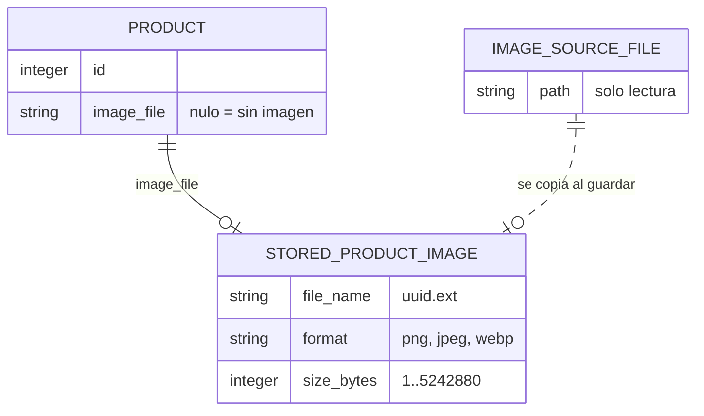

# Especificación funcional — U1 product-image

## Resumen

Esta unidad permite asignar, cambiar y quitar una imagen opcional a cada producto. Implementa FR4.1–FR4.14, con la regla de placeholder compartida con U3.

Decisiones de esta etapa (`functional-design-questions.md`):
- **Q1 = A**: la pantalla carga la imagen directamente desde la carpeta de imágenes de producto mediante el protocolo de archivos de la app, limitado a esa carpeta, y solo cuando la tarjeta aparece en pantalla. No se generan miniaturas.
- **Q2 = A**: se valida la firma del archivo (primeros bytes). Un archivo dañado por dentro se acepta y se ve como placeholder.

Esta unidad toca estos componentes existentes (`codekb/almanza-pos-desktop/component-inventory.md`):
- slice de catálogo de productos (Rust): caso de uso, puerto, adaptador SQLite y comandos;
- migraciones;
- modelo `Product`;
- `find_product` del slice de ventas, que mapea su propio `Product`;
- `ProductsPage` y `ProductService` (frontend);
- configuración de seguridad de la app.

## Diagrama entidad-relación (derivado de `entities.md`)



Texto alternativo: un producto tiene cero o una copia de imagen, referida por el nombre de archivo en `image_file`. El archivo elegido por el usuario se copia al guardar y nunca se modifica.

## Operaciones (interfaces)

Las operaciones se definen a nivel lógico. Los nombres de comandos son propuestas para Code Generation y siguen el estilo de los comandos existentes.

| Operación | Entrada | Salida | Reglas |
|---|---|---|---|
| Inspeccionar imagen de origen | ruta del archivo elegido | `ImagePreview` (formato, tamaño, vista previa) o error de validación | BR1.1–BR1.4 |
| Crear producto | datos actuales del producto + `ImageChange` (`keep` o `replace`) | `Product` con `image_file` | Reglas actuales + BR5.1, BR2.1, BR2.2 |
| Actualizar producto | datos parciales actuales + `ImageChange` (`keep`, `replace` o `remove`) | `Product` | Reglas actuales + BR5.1, BR2.1–BR2.3, BR2.7 |
| Eliminar producto | id | nada | Regla actual (no se elimina con ventas) + BR2.4, BR2.7 |
| Obtener la carpeta de imágenes | — | ruta absoluta de la carpeta de imágenes de producto | BR3.2 |
| Fuente mostrable (frontend, contrato con U3) | `image_file` y la carpeta | fuente mostrable o nada | BR2.6, BR3.1, BR3.2 |

### Contrato de visualización para U3

```text
productImageSource(image_file: string | null): string | null
  - null si image_file es null o no cumple <uuid-v4>.(png|jpg|webp)
  - si no, la URL del protocolo de archivos de la app para <carpeta>/<image_file>
  - la carpeta se obtiene una vez (operación "Obtener la carpeta de imágenes") y se guarda en memoria
  - quien muestra la imagen usa placeholder mientras carga y si falla (BR3.1)
```

El campo `image_file` viaja en el `Product` de todas las operaciones existentes que devuelven productos (listar, activos, buscar, por código, por id), así que U2 y U3 lo reciben sin cambios adicionales.

## Flujos

### W1 — Elegir una imagen en el formulario (FR4.2–FR4.5)

1. El administrador pulsa "Elegir imagen" o "Cambiar imagen".
2. Se abre el selector nativo con el filtro "Imágenes (png, jpg, jpeg, webp)".
3. Si cancela el selector, fin sin cambios.
4. Con la ruta elegida, se pide "Inspeccionar imagen de origen".
5. Si es válida, el campo pasa a `pending-new` con la vista previa y el caption "Se aplicará al guardar". No se copia nada (BR2.1).
6. Si no es válida, el campo muestra el error de la regla que falló, el cambio pendiente anterior se conserva y los demás campos no cambian.

### W2 — Guardar un producto nuevo con imagen (FR4.1, FR4.6)

1. Se validan los datos del producto con las reglas existentes y la imagen (BR1.1–BR1.4, BR5.1).
2. Se copia la imagen a la carpeta como `<uuid>.<ext>`: primero un temporal y luego se renombra (BR2.1).
3. Se inserta el producto con su `image_file` en una transacción.
4. Si el paso 3 falla, se borra la copia del paso 2 y se devuelve el error (BR2.2).
5. Se devuelve el `Product` creado; el diálogo se cierra y la lista se recarga.

### W3 — Reemplazar la imagen (FR4.9)

Igual que W2, pero en el paso 3 se actualiza el producto. La copia anterior se lee dentro de la misma transacción de actualización, y esa es la que se borra después de confirmar (BR2.2), de modo que dos guardados seguidos no borran una copia ya reemplazada. Si ese borrado falla, se registra una advertencia y el guardado sigue siendo exitoso (BR2.7).

### W4 — Quitar la imagen (FR4.8)

1. En el formulario, "Quitar imagen" marca el cambio pendiente `remove` y ofrece "Deshacer" (BR5.2).
2. Al guardar, se actualiza el producto con `image_file = nulo`.
3. Después de confirmar, se borra la copia anterior (BR2.3, BR2.7).

### W5 — Cancelar el formulario (FR4.7)

Se descarta el cambio pendiente. No se copia ni se borra nada y el producto no cambia.

### W6 — Eliminar un producto (FR4.10)

1. Se lee el producto primero y se conserva su `image_file`. Luego se elimina con la regla actual, que lo rechaza si el producto tiene ventas o ajustes.
2. Si la eliminación se confirma y había copia, se borra la copia validada con BR2.6 (BR2.4, BR2.7).
3. Si se rechaza, la copia no se toca.

### W7 — Mostrar una imagen (FR4.12, contrato con U3)

1. Con `image_file` nulo o inválido, se muestra el placeholder (BR2.6, BR3.1).
2. Si no, se muestra el placeholder mientras carga la fuente del contrato.
3. Si carga bien, se muestra la imagen.
4. Si falla (archivo borrado o dañado), se muestra el placeholder. En el formulario se agrega la nota "No se encontró la imagen guardada" (estado `missing`).

### W8 — Migración (FR4.13)

Al arrancar, la migración `0007` agrega la columna opcional a `products`. Ningún otro dato cambia (BR4.1).

## Máquina de estados del campo de imagen en el formulario

| Estado actual | Evento | Condición | Estado siguiente | Acción |
|---|---|---|---|---|
| empty | Elegir imagen | archivo válido | pending-new | Mostrar vista previa |
| empty | Elegir imagen | archivo inválido | error | Mostrar motivo |
| saved | Cambiar imagen | archivo válido | pending-new | Mostrar vista previa |
| saved | Cambiar imagen | archivo inválido | saved (con error visible) | Mostrar motivo |
| saved | Quitar imagen | — | pending-remove | Mostrar placeholder y "Deshacer" |
| saved | La imagen falla al cargar | — | missing | Mostrar placeholder y nota |
| missing | Elegir imagen | archivo válido | pending-new | Mostrar vista previa |
| missing | Quitar imagen | — | pending-remove | — |
| pending-new | Quitar imagen | había imagen guardada | pending-remove | — |
| pending-new | Quitar imagen | no había imagen guardada | empty | — |
| pending-new | Cambiar imagen | archivo válido | pending-new | Nueva vista previa |
| pending-remove | Deshacer | — | saved (o missing) | — |
| error | Elegir imagen | archivo válido | pending-new | — |
| cualquiera | Guardar | éxito | (diálogo cerrado) | Aplicar W2, W3 o W4 |
| cualquiera | Guardar | falla | el mismo estado | Alert del diálogo; el producto conserva su imagen |
| cualquiera | Cancelar | — | (diálogo cerrado) | W5 |

Todos los estados pueden pasar a guardado o a cancelado, y ninguno queda sin salida.

## Componentes de frontend afectados

Esta unidad es `service`, así que no lleva `frontend-components.md`. Lo mínimo para Code Generation:
- **`ProductImageField`**: componente nuevo con los estados de la tabla anterior. Recibe la imagen guardada, el cambio pendiente y su callback, y la bandera de "guardando".
- **`ProductsPage`**: el diálogo pasa a `maxWidth="md"` en dos columnas; el formulario guarda el cambio pendiente de imagen y lo envía al crear o actualizar.
- **`ProductService`**: operaciones de inspeccionar imagen y obtener la carpeta; crear y actualizar aceptan el cambio de imagen.
- **Tipos**: `Product.image_file: string | null` y el tipo del cambio de imagen.
- **Contrato**: un helper o hook `productImageSource` en el módulo de productos, que U3 importa.

## Configuración de la app

- Habilitar el protocolo de archivos (asset protocol) de Tauri con alcance solo `<carpeta de datos de la app>/product-images/**` (BR3.2). La CSP sigue en `null`, igual que hoy; no se amplía ningún otro permiso.
- En Tauri 2 esto exige la característica de Cargo `protocol-asset` en `src-tauri/Cargo.toml`, más `app.security.assetProtocol.enable = true` y `scope` en `tauri.conf.json`.
- La variable de ruta `$APPDATA` del alcance ya resuelve a la carpeta de datos de la app (`app_data_dir`, que incluye el identificador de la app). Por eso el alcance es `$APPDATA/product-images/**`: repetir el identificador apunta a una carpeta que no existe y el protocolo responde 403 Forbidden. Debe coincidir con la carpeta que usa el almacenamiento (`<app_data_dir>/product-images`).
- "Obtener la carpeta de imágenes" devuelve esa ruta absoluta y la pantalla arma la URL con `convertFileSrc`, que en Windows genera `http://asset.localhost/<ruta codificada>`.

## Resumen de reglas (derivado de `rules.md`)

| Grupo | Reglas | Tema |
|---|---|---|
| BR1 | BR1.1–BR1.4 | Validación del archivo de origen |
| BR2 | BR2.1–BR2.7 | Copia, guardado todo o nada, borrado y confinamiento |
| BR3 | BR3.1–BR3.3 | Visualización y placeholder |
| BR4 | BR4.1 | Migración |
| BR5 | BR5.1–BR5.2 | Cambio de imagen en peticiones y formulario |

## Errores

| Situación | Mensaje al usuario | Regla |
|---|---|---|
| Extensión no permitida | "Formato no permitido. Usa PNG, JPG o WebP." | BR1.1 |
| Firma no válida | "El archivo no es una imagen PNG, JPG o WebP válida." | BR1.2 |
| Más de 5 MB | "La imagen pesa {n} MB. El máximo es 5 MB." | BR1.3 |
| Archivo vacío | "El archivo está vacío." | BR1.3 |
| Archivo inexistente | "No se encontró el archivo." | BR1.4 |
| Sin permiso de lectura | "No hay permiso para leer el archivo." | BR1.4 |
| Falla la copia | "No se pudo guardar la imagen: {motivo}" | BR2.1 |
| Cambio de imagen mal formado | "Cambio de imagen no válido." | BR5.1 |
| No se pudo borrar la copia vieja | (sin mensaje; advertencia en el registro) | BR2.7 |

## Escenarios de prueba (resumen para Code Generation)

- **Rust**:
  - firma PNG, JPEG y WebP válida e inválida;
  - extensión;
  - límites de tamaño: 0, 5 242 880 y 5 242 881;
  - archivo inexistente;
  - nombre generado con extensión según la firma;
  - confinamiento: `../x.png`, ruta absoluta y nombre con separador → sin imagen;
  - en una creación con falla de la base, la copia nueva se borra;
  - reemplazo y quitar borran la copia vieja;
  - eliminar con ventas no borra la copia;
  - la migración conserva productos y deja `image_file` nulo;
  - el original sigue intacto.
- **Vitest**: transiciones de la máquina de estados del campo (lógica pura) y `productImageSource` (nulo, inválido, válido).

## Sources

- `requirements-analysis/requirements.md`: FR4.1–FR4.14, AC4.1–AC4.9, NFR2, NFR4, NFR5.
- `refined-mockups/mockups.md` (M5, M6) e `interaction-spec.md` (`ProductImageField`).
- `units-generation/unit-of-work.md` y `unit-of-work-dependency.md` (contrato con U3).
- `functional-design-questions.md`: Q1 = A, Q2 = A.
- `codekb/almanza-pos-desktop/architecture.md`, `component-inventory.md`, `code-quality-assessment.md`.

## Assumptions & Open Questions

- [assumption] Al no generar miniaturas (Q1 = A), cumplir NFR2 depende de la carga diferida en U3; con 500 imágenes de 5 MB la memoria puede crecer. Se acepta para la prueba de concepto; las miniaturas quedan como mejora futura si la medición en Build and Test no cumple. Umbral que las activaría: con 500 productos con imagen, la primera pintura de la cuadrícula tarda más de 2 s o la memoria de la WebView supera 500 MB.
- [assumption] El diálogo de producto muestra la vista previa de un archivo aún no guardado con el contenido que devuelve "Inspeccionar imagen de origen" (una sola imagen de 5 MB o menos), porque el protocolo de archivos está limitado a la carpeta de la app.
