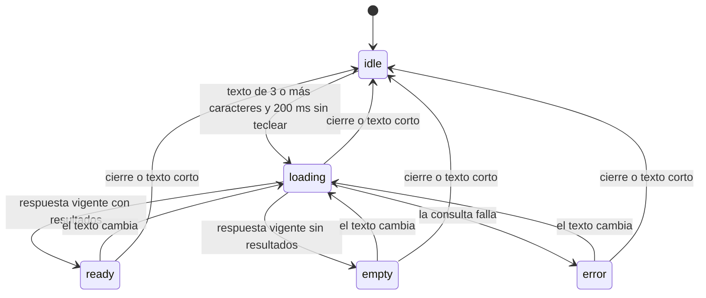

# Especificación funcional — U2 search-suggestions

Unidad `ui` (U2). Agrega sugerencias de búsqueda en vivo bajo la barra del POS en vista de lista. No hay entidades ni reglas de negocio propias: esta especificación es autónoma y define los flujos, los estados y el contrato del backend. Los componentes y su comportamiento visual están en `frontend-components.md`.

## Decisiones de este diseño

- **Q1 = B**: las sugerencias se calculan en el backend, con un comando nuevo que normaliza acentos y mayúsculas. No se filtra en la pantalla [Q1].
- **Q2 = B**: al elegir una sugerencia se vuelve a leer el producto por id antes de agregarlo, para validar con el stock real de ese momento [Q2]. La pregunta estaba condicionada a la opción A de Q1; se aplica de todos modos porque es la elección de la persona y es coherente con el backend: la lista trae el stock del momento de la consulta, y la relectura cubre los segundos entre ver la lista y elegir.
- La **regla de coincidencia** (FR1.2) vive una sola vez, en el backend. U3 la consume llamando al mismo comando sin límite, así que no se duplica en TypeScript.
- El comando `search_products` actual (con `LIKE`, 20 resultados, sensible a acentos) **no cambia**: lo siguen usando el flujo de Enter y el diálogo "Buscar Producto" (FR1.12).

## Contrato del backend

Comando nuevo `suggest_products` en el slice `catalog/products`:

```text
suggest_products(term: texto, limit: número opcional) -> lista de Product
```

- **Solo productos activos** (`active = 1`).
- **Normalización** del texto y de los campos comparados: se recorta el texto (sin espacios al inicio ni al final), se translitera a ASCII con `deunicode` (dependencia que el backend ya usa en `printer/utils.rs`, sin agregar otra) y se pasa a minúsculas. Eso quita los acentos y marcas diacríticas (`á é í ó ú ü ñ ç` y sus mayúsculas). "jamon" encuentra "Jamón" y "LECHE" encuentra "leche". Los caracteres de otros alfabetos se transliteran a su equivalente latino aproximado; para un catálogo en español es irrelevante y la regla sigue siendo "contiene".
- **Coincidencia**: el nombre **o** el código de barras normalizados **contienen** el texto normalizado, en cualquier posición. La comparación es de subcadena literal: `%` y `_` no son comodines.
- **Orden** (presentación, no cambia el conjunto): primero los productos cuyo nombre o código **empieza** con el texto, luego el resto; cada bloque por nombre ascendente normalizado. Así lo más probable queda en las 3 filas visibles.
- **Límite**: `limit` ausente devuelve todos los que coinciden (lo usa U3); U2 envía 10 (FR1.3). Un `limit` de 0 devuelve una lista vacía; el tipo es un entero sin signo, así que un valor negativo no se puede expresar.
- **Texto vacío** tras recortar devuelve una lista vacía. El mínimo de 3 caracteres lo aplica la pantalla (FR1.1), no el backend, para que U3 pueda filtrar desde el primer carácter (FR2.6).
- **Errores**: una falla de base de datos se devuelve como el error estándar del backend; la pantalla lo muestra con el `Alert` del POS (W7).
- Cada resultado es un `Product` completo, igual que el de `search_products`, con precio, stock, unidad, `is_bulk`, código e `image_file`.

## Reglas de la lista de sugerencias

Referencias internas de esta especificación (no son `BRx.y`; este diseño no tiene `rules.md`):

- **L1 — Disparo.** La pantalla pide sugerencias cuando el texto, recortado, tiene 3 caracteres o más y han pasado 200 ms sin teclear (FR1.1, NFR1).
- **L2 — Resultados.** Hasta 10 sugerencias, 3 visibles; el resto con scroll dentro de la lista (FR1.3).
- **L3 — Contenido.** Cada fila muestra nombre, código, precio y stock con su unidad; "A granel" y "Agotado" como chips cuando aplican (FR1.4, FR1.8).
- **L4 — Respuesta vigente.** Cada consulta lleva un número de secuencia. Cualquier cambio de texto, incluso borrarlo, invalida las consultas en vuelo; solo se aplica la respuesta de la consulta más reciente (FR1.11).
- **L5 — Resaltado.** Ninguna fila está resaltada al abrir la lista y cualquier cambio de texto quita el resaltado (FR1.6).
- **L6 — Agotado.** Un producto con `stock <= 0` se muestra marcado y no se agrega (FR1.8).
- **L7 — Cierre.** La lista se cierra con Esc, Tab, texto de menos de 3 caracteres, clic fuera, pérdida de foco, al agregar un producto y al desactivar las sugerencias (FR1.10).

## Estados de la lista

| Estado | Qué se ve | Cómo se llega |
|---|---|---|
| `idle` | Sin lista | texto de menos de 3 caracteres, lista cerrada o sugerencias desactivadas |
| `loading` | Solo una barra de progreso de 2 px bajo el campo. Las filas de la consulta anterior se ocultan: corresponden a otro texto y no se pueden resaltar ni elegir | consulta en vuelo |
| `ready` | Lista con 1 a 10 filas | respuesta vigente con resultados |
| `empty` | Fila "Sin coincidencias" (FR1.9) | respuesta vigente sin resultados |
| `error` | Lista cerrada y `Alert` de error del POS; Enter sigue funcionando | la consulta falló |



Texto alternativo del diagrama: de `idle` se pasa a `loading` al cumplir la regla L1; `loading` termina en `ready`, `empty` o `error` según la respuesta vigente; cualquier cambio de texto desde `ready`, `empty` o `error` vuelve a `loading`, y cualquier cierre o texto corto vuelve a `idle` desde cualquier estado.

## Teclado

| Tecla | Lista cerrada | Lista abierta sin resaltado | Lista abierta con resaltado |
|---|---|---|---|
| ↓ | — | Resalta la 1.ª fila | Resalta la siguiente; se detiene en la última |
| ↑ | — | — | Resalta la anterior; en la 1.ª quita el resaltado |
| Enter | Flujo actual | Flujo actual | Agrega la sugerencia resaltada |
| Esc | — | Cierra la lista y conserva el texto | Cierra la lista y conserva el texto |
| Tab | Foco al siguiente control | Cierra la lista y pasa el foco | Cierra la lista y pasa el foco |

El resaltado desplaza la lista para mantener visible la fila resaltada (FR1.5). Mientras el estado es `loading` no hay filas visibles: ↓ y ↑ no hacen nada y Enter ejecuta el flujo actual, así que nunca se agrega un producto que no coincide con el texto escrito (FR1.11). Al llegar la respuesta vigente la lista aparece sin fila resaltada.

## Flujos

### W1 — Escribir y ver sugerencias (FR1.1, FR1.3, FR1.9; AC1.1, AC1.2, AC1.3, AC1.9)

1. El cajero escribe en la barra de búsqueda en vista de lista.
2. Con menos de 3 caracteres, la lista sigue cerrada (AC1.2).
3. Con 3 o más y 200 ms sin teclear, la pantalla pide `suggest_products` con límite 10.
4. Si la respuesta vigente trae resultados, se abre la lista con hasta 10 filas y 3 visibles (AC1.1, AC1.3); si no trae ninguno, muestra "Sin coincidencias" (AC1.9).

### W2 — Navegar con el teclado (FR1.5; AC1.4, AC1.10)

1. ↓ y ↑ mueven el resaltado según la tabla de teclado; la lista se desplaza para mostrar la fila resaltada.
2. Esc cierra la lista y deja el texto escrito (AC1.10).
3. Tab cierra la lista y pasa el foco.

### W3 — Agregar una sugerencia (FR1.7; AC1.4, AC1.7)

1. El cajero elige una sugerencia con Enter sobre la fila resaltada o con un clic (AC1.4).
2. La pantalla lee de nuevo el producto por id (`get_product`) para tener el stock real [Q2].
3. Si la lectura falla o el producto ya no está activo, se muestra "Producto no encontrado" (mensaje actual) y la lista se cierra. No se reconsulta: la lista vuelve a abrirse con el siguiente cambio de texto.
4. Si el producto es a granel y tiene stock, se abre el diálogo de cantidad a granel existente (AC1.7). Si no es a granel, se agrega con cantidad 1 con la validación de stock actual.
5. Al agregarse, se limpia la barra, se cierra la lista y el foco vuelve a la barra (AC1.4). Si el cajero cancela el diálogo a granel, la barra conserva el texto.

### W4 — Sugerencia agotada (FR1.8; AC1.8)

1. Una sugerencia con `stock <= 0` se muestra con el chip "Agotado"; se puede resaltar.
2. Al elegirla, tras la relectura de W3, se muestra el mensaje actual "Stock insuficiente. Disponible: 0" (AC1.8). No se abre el diálogo a granel aunque el producto sea a granel, y la venta no cambia.
3. La lista se cierra y la barra conserva el texto.

### W5 — Enter sin resaltado y escaneo (FR1.5, FR1.6, FR1.12; AC1.5, AC1.6)

1. Con la lista cerrada, o abierta sin fila resaltada, Enter ejecuta el flujo actual sin cambios: código exacto, luego búsqueda de coincidencias, luego agregar o abrir el modal de selección, o el error "Producto no encontrado" (AC1.6).
2. Un escaneo (texto rápido y Enter, sin flechas) siempre cae aquí, porque cada tecla quita el resaltado y las sugerencias esperan 200 ms (AC1.5).
3. Al enviar el formulario por el flujo actual, lo primero y de forma síncrona (antes de cualquier `await`) es **cerrar la lista e invalidar la secuencia** de consultas (L4). No se depende del vaciado de la barra, que hoy ocurre en el `finally`, después de las consultas por código y por coincidencias: en ese lapso el texto sigue igual y una respuesta tardía o el temporizador de 200 ms podrían reabrir la lista. Mientras el flujo de Enter está en curso no se abre la lista; el siguiente cambio de texto la habilita de nuevo.

### W6 — Cierre de la lista (FR1.10)

La lista se cierra en cualquiera de los casos de L7. Después de un clic en una fila, el campo no pierde el foco antes de procesar la selección.

### W7 — Falla la consulta (corner-checklist "Loading, empty, and error")

1. La pantalla cierra la lista y muestra el mensaje con el `Alert` de error del POS, que se limpia solo a los 3 s como los demás errores del POS.
2. Mientras el mismo mensaje siga visible no se vuelve a mostrar (con fallas repetidas el aviso no se reabre en cada pausa de tecleo ni tapa un mensaje de stock más reciente).
3. Enter sigue usando el flujo actual; el siguiente cambio de texto vuelve a intentar.

### W8 — Respuesta vieja (FR1.11)

Si llega la respuesta de un texto anterior después de la de uno más reciente, o después de que el texto bajó de 3 caracteres, se descarta y la lista no cambia.

## Casos límite resueltos

| Caso | Decisión |
|---|---|
| Producto que cambia de stock entre la consulta y la elección | La relectura de W3 usa el stock real |
| Producto desactivado o eliminado entre la consulta y la elección | "Producto no encontrado" y nueva consulta (W3 paso 3) |
| Escaneo con la lista abierta | Enter sin resaltado = flujo actual (W5) |
| Texto con `%` o `_` | Se busca literal; no son comodines |
| Texto con acentos o mayúsculas distintos al producto | Se normaliza en ambos lados |
| Sugerencias desactivadas por U3 (`suggestionsEnabled = false`) | No se consulta ni se muestra la lista; Enter conserva el flujo actual |
| Catálogo vacío o sin coincidencias | "Sin coincidencias" |
| Más de 10 coincidencias | Se muestran las 10 primeras según el orden de presentación |

## Rendimiento (NFR1)

- Presupuesto de 300 ms desde la última tecla con 5 000 productos activos: 200 ms de espera y 100 ms para consulta, normalización, orden y dibujo.
- El backend carga los productos activos con la consulta existente (`find_active`) y filtra y ordena en memoria. Con 5 000 filas el costo esperado es de unos milisegundos; se mide en Build and Test con una base de 5 000 productos.
- Si la medición no cumple, la salida acotada es una consulta SQL previa con una columna normalizada, sin cambiar este contrato.
- **Criterio de aceptación en Build and Test**: con 5 000 productos activos, la lista aparece en 300 ms o menos desde la última tecla (NFR1) y el filtro de la cuadrícula de U3 actualiza en 500 ms o menos (NFR2). Un resultado fuera de esos umbrales es un fallo de la verificación, no un hallazgo opcional.

## Integración con U3

- U2 expone `suggestionsEnabled` en `PosSearchBar` (por defecto `true`). U3 lo pone en `false` en vista de cuadrícula.
- La cuadrícula de U3 filtra con el mismo comando `suggest_products`, sin límite y desde el primer carácter (FR2.6), para usar exactamente la misma regla de coincidencia.
- Con 1 o 2 letras casi todo el catálogo coincide, así que cada consulta de U3 puede serializar miles de `Product`. U3 debe aplicar su propio control de respuestas vigentes (el mismo patrón de secuencia de L4), un retardo corto (100 ms según la especificación de interacción) y decidir en su propio diseño si filtra en pantalla sobre la lista ya cargada. Esa decisión de U3 no cambia este contrato.

## Pruebas previstas

- **Rust**: normalización (acentos, `ñ`, mayúsculas, marcas combinantes), coincidencia por nombre y por código, `%` y `_` literales, solo activos, orden de "empieza con" y límite, texto vacío; con un repositorio falso en memoria.
- **Vitest** (entorno `node`, lógica pura): regla de disparo, máquina de estados con secuencia y descarte de respuestas viejas, resaltado (↓, ↑, tope, reinicio por texto) y decisión de Enter (resaltado = agregar, sin resaltado = flujo actual).
- **Regresión de Enter** (NFR3): la decisión de Enter con y sin resaltado, en `loading` y con escaneo rápido; el cierre y la invalidación síncronos al enviar el formulario (una respuesta tardía no reabre la lista); el flujo de código exacto no cambia.

## Sources

- `inception/units-generation/unit-of-work.md` (U2) y `unit-of-work-story-map.md`: responsabilidades y requisitos de la unidad.
- `inception/requirements-analysis/requirements.md`: FR1.1–FR1.12, AC1.1–AC1.10, NFR1, NFR3, NFR6.
- `inception/refined-mockups/interaction-spec.md`: tabla de teclado, estados, retardos de 200 ms y accesibilidad de `PosSearchBar`.
- `functional-design-questions.md` de esta unidad: [Q1] = B y [Q2] = B.
- Código actual: `src/modules/pos/components/PosSearchBar.tsx`, `src/modules/catalog/products/services/ProductService.ts`, `src-tauri/src/modules/catalog/products/` (`search_products`, `get_active_products`, `get_product`) y `src-tauri/src/constants.rs`.
- [scope] Workflow-selected scope: plan a la medida basado en refactor; prueba de concepto sin despliegue.

## Assumptions & Open Questions

- [assumption] La `ñ` se normaliza como `n` ("pina" encuentra "Piña"), igual que cualquier marca diacrítica, que es lo que hace `deunicode` y lo más permisivo para el cajero. El flujo de Enter con código exacto no se ve afectado.
- [assumption] La normalización usa `deunicode`, que ya está en `Cargo.toml`; no se agrega una dependencia nueva y los alfabetos no latinos se transliteran a su equivalente aproximado.
- [assumption] "Empieza con" se evalúa sobre el nombre o el código normalizados, como define la especificación de interacción.
- [assumption] El presupuesto de 100 ms para consulta y dibujo con 5 000 productos se confirma midiendo en Build and Test.
- Q2 estaba condicionada a la opción A de Q1; se aplica la relectura al elegir de todos modos, por indicación de la persona.
