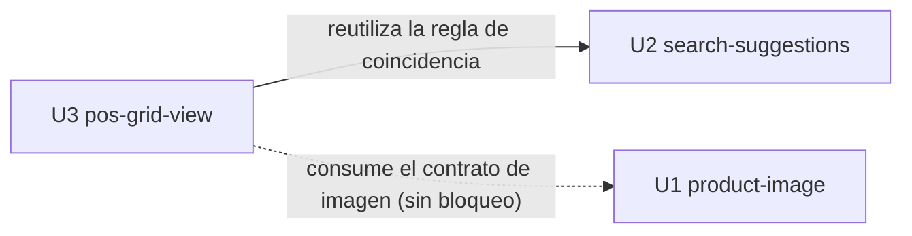

# Dependencias entre unidades de trabajo

Este documento describe solo la topología: qué depende de qué. El orden de construcción se elige después.

## Grafo de dependencias



Texto alternativo:
- U3 (`pos-grid-view`) depende de U2 (`search-suggestions`) porque reutiliza su regla de coincidencia y normalización de texto.
- U3 consume el contrato de visualización de imagen que define U1 (`product-image`), pero **no depende** de U1 para construirse: sin U1, la tarjeta muestra el placeholder (respuesta P2).
- U1 y U2 no dependen de ninguna otra unidad.

## Aristas

| Desde (depende) | Hacia | Tipo | Motivo |
|---|---|---|---|
| U3 | U2 | Dependencia de construcción | U3 filtra la cuadrícula con la misma regla de FR1.2 (contiene, sin mayúsculas ni acentos), que U2 implementa como módulo reutilizable |

La relación U3 → U1 es un **punto de integración sin dependencia de construcción**. Por eso no aparece en el bloque YAML.

## Puntos de integración

| Punto | Proveedor | Consumidor | Mecanismo | Comportamiento ante ausencia o falla |
|---|---|---|---|---|
| Regla de coincidencia y normalización | U2 | U3 | Módulo o función TypeScript compartida (o comando de búsqueda del backend, si Functional Design de U2 lo decide) | Obligatoria para U3 |
| Contrato de imagen de producto: campo opcional en `Product` y forma de obtener una fuente mostrable | U1 | U3 | Campo del modelo `Product` (Rust y TS) y comando o URL que se define en Functional Design de U1 | Si el campo falta o es nulo, o la imagen está cargando o falla, la tarjeta muestra el placeholder (FR4.12) |
| Flujo de selección y agregado al carrito (`handleProductSelected`, `BulkQuantityDialog`, validación de stock) | Código existente de `PosSearchBar` (U2 lo extrae o expone) | U2 y U3 | Función o hook compartido del módulo `pos` | Sin cambios de comportamiento |
| Carrito (`PosProvider` / `posReducer`) | Código existente | U2 y U3 | Acciones `ADD_ITEM`, `INCREMENT`, `SET_INPUT` y `REMOVE_ITEM` sin cambios | Sin cambios |
| Modelo `Product` en Rust (catálogo y el `find_product` de `sales`) | U1 | Todas | Se agrega un campo anulable; U2 y U3 lo ignoran o lo pasan tal cual | Los productos sin imagen siguen funcionando igual |

**Archivos que tocan dos unidades**:
- `src/modules/pos/components/PosSearchBar.tsx`: U2 agrega las sugerencias y U3 el selector de vista y la desactivación de sugerencias.
- `src/modules/pos/pages/POSPage.tsx`: U3 cambia la distribución.
- `src/modules/catalog/products/types.ts`: U1 agrega el campo de imagen y U3 lo lee.

Hay que coordinar los cambios en estos archivos al integrar.

## Oportunidades de desarrollo en paralelo

- **U1 y U2** son independientes entre sí y se pueden construir en paralelo.
- **U1 y U3** también se pueden construir en paralelo: U3 solo necesita el contrato de imagen fijado en el diseño, no la implementación de U1.
- **U3** necesita la regla de coincidencia de U2.

Órdenes topológicos válidos: U1 → U2 → U3, U2 → U1 → U3 y U2 → U3 → U1. U1 puede ir en cualquier posición.

## Bloque de aristas (machine-readable)

```yaml
units:
  - name: product-image
    kind: service
    depends_on: []
  - name: search-suggestions
    kind: ui
    depends_on: []
  - name: pos-grid-view
    kind: ui
    depends_on: [search-suggestions]
```

## Sources

- `unit-of-work.md` (definición de U1–U3).
- `units-generation-questions.md`: P1 = A, P2 = independientes con placeholder.
- `requirements-analysis/requirements.md`: FR1.2, FR2.6, FR4.12.
- `codekb/almanza-pos-desktop/architecture.md` y `code-structure.md` (archivos afectados).

## Assumptions & Open Questions

- [assumption] El flujo de selección compartido (`handleProductSelected`) se extrae a un hook o función del módulo `pos` en la unidad que llegue primero a necesitarlo compartido. Es un detalle de Functional Design, no una dependencia nueva entre unidades.
